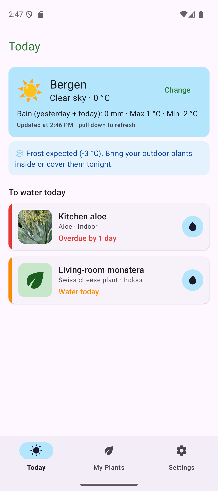
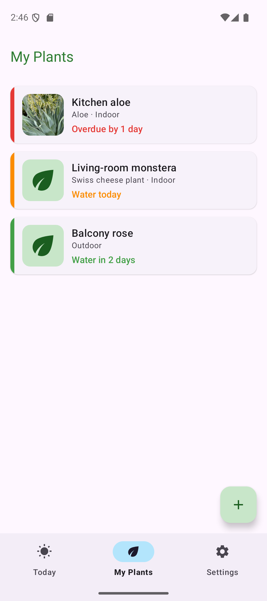
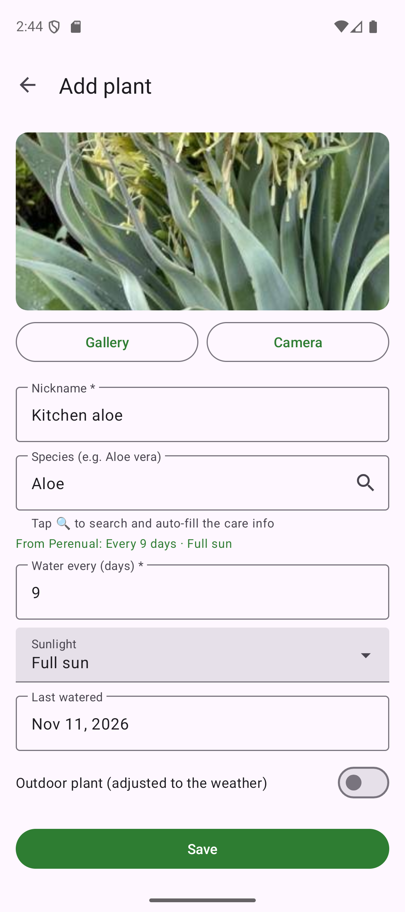
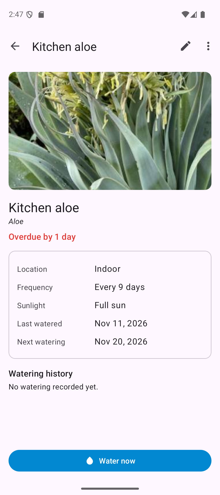
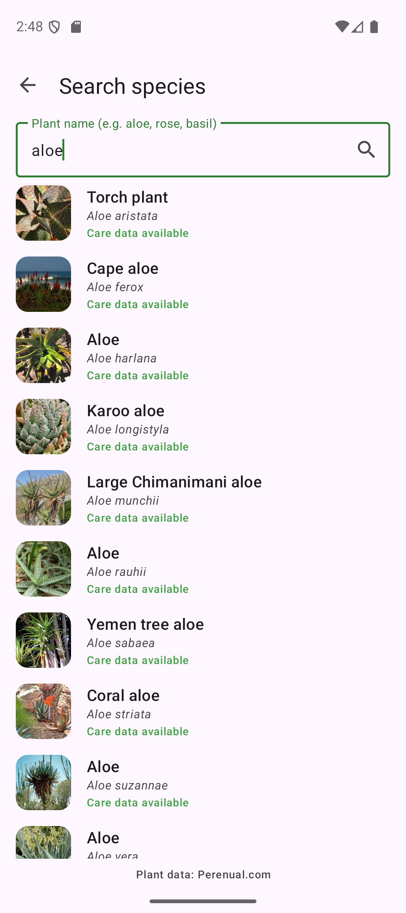
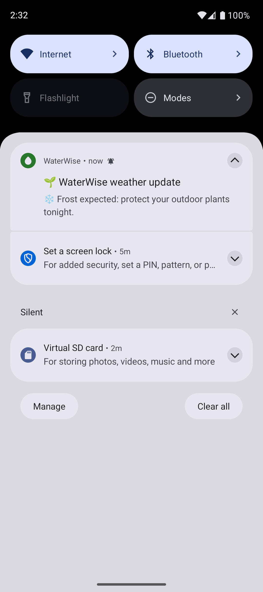
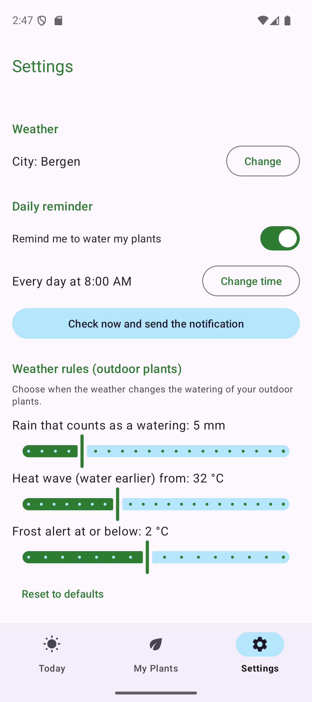

# 🌱 WaterWise — weather-aware plant watering

**WaterWise** is an Android app (Java + XML) that reminds you when to water each of your
plants, and **adapts the schedule of outdoor plants to the real weather**: rain counts as
a watering, a heat wave brings the next watering forward, and frost triggers an alert.

> 📦 **Download the APK:** see the [Releases](../../releases) page (`WaterWise-v1.0.apk`, Android 8.0+).

---

## The problem

Houseplants and balcony plants often die for a simple reason: people forget to water them,
or they water them on a fixed schedule that ignores the weather. An outdoor plant gets
watered right after a storm, dries out during a heat wave, or freezes on a cold night
because nobody warned its owner.

## The solution

| | Feature |
|---|---|
| 🪴 | **My plants**: photo, species, indoor/outdoor, watering interval, sunlight, notes |
| 🔍 | **Species search** (Perenual API): pick a species and the form fills itself (watering frequency, sunlight, photo) |
| ☀️ | **Today screen**: live weather for your city, alerts, and the plants to water today with a one-tap 💧 button |
| 🌦️ | **Weather-aware schedule** for outdoor plants (Open-Meteo API) — see the rules below |
| 🔔 | **Daily reminder** at the time you choose, even when the app is closed (WorkManager) |
| 📜 | **Watering history** per plant, including the weather adjustments |
| 📴 | **Works offline**: local database, cached species and last forecast |
| 🌙 | Material 3 design, light and dark mode |

### The weather rules (outdoor plants only)

| Rule | Condition (adjustable in Settings) | Effect |
|---|---|---|
| 🌧️ Rain | ≥ 5 mm of rain yesterday + today, plant due within a day | The rain counts as a watering: next watering postponed by a full interval |
| 🔥 Heat | ≥ 32 °C today or tomorrow | Plants dry faster: next watering moved to **half** the interval |
| ❄️ Frost | ≤ 2 °C today or tomorrow | Alert: bring the plants inside or cover them |

The rules are *idempotent*: refreshing the weather several times a day never shifts a
plant twice. They are covered by unit tests (`WeatherAdvisorTest`).

## Screenshots

| Today | My plants | Add plant (auto-filled) |
|---|---|---|
|  |  |  |

| Plant detail | Species search | Notification | Settings |
|---|---|---|---|
|  |  |  |  |

## External APIs

| API | Used for | Key |
|---|---|---|
| [Perenual](https://perenual.com/docs/api) `species-list`, `species/details/{id}` | Species search, watering frequency, sunlight, picture | Free key |
| [Open-Meteo Geocoding](https://open-meteo.com/en/docs/geocoding-api) | City name → coordinates | None |
| [Open-Meteo Forecast](https://open-meteo.com/en/docs) | Rain, min/max temperature, weather code (yesterday → tomorrow) | None |

Handling of the Perenual free plan: care details are only available for species with
id ≤ 3000 (others answer HTTP 429), so the app never requests locked species and asks the
user to choose *Frequent / Average / Minimum* instead. Results are cached in Room to save
the daily quota, and pictures are downloaded because their URLs expire after 24 h.

## Architecture

```
Activities / Fragments (XML layouts, ViewBinding)
        │ observe LiveData
        ▼
ViewModels ───────────────► Repositories ──► Room (SQLite): plants, watering_logs, species_cache
                               │
                               ├──► Retrofit + OkHttp ──► Perenual / Open-Meteo
                               └──► SharedPreferences (city, thresholds, reminder)

WorkManager ──► DailyCheckWorker ──► WeatherRepository + notification
```

| Package | Content |
|---|---|
| `data` | Room entities/DAOs, `AppDatabase` (v2 + migration), `PlantRepository`, `SpeciesRepository` |
| `network` | `ApiClient` (OkHttp, Retrofit, API-key interceptor), API interfaces, JSON models |
| `weather` | `WeatherAdvisor` (rules), `WeatherRepository`, `DailyWeather`, `WeatherCodes` |
| `notifications` | `DailyCheckWorker`, `ReminderScheduler`, `Notifications` |
| `ui` | `today`, `plants`, `species`, `settings`, `weather` screens |
| `util` | `CareMapper`, `WateringStatus`, `PhotoStorage`, `AppSettings`, … |

**Libraries:** AndroidX (AppCompat, Fragment, RecyclerView, Lifecycle, Room, WorkManager,
SwipeRefreshLayout), Material Components 3, Retrofit 2 + Gson, OkHttp, Glide.

## Build it yourself

1. Clone the repo and open it in **Android Studio** (JDK 17, Android SDK 36).
2. Get a free API key on [perenual.com](https://perenual.com/docs/api) and add it to
   `local.properties` (this file is git-ignored, the key is never published):
   ```properties
   PERENUAL_API_KEY=sk-your-key
   ```
3. Run the app, or build the APK:
   ```bash
   ./gradlew assembleDebug        # app/build/outputs/apk/debug/app-debug.apk
   ./gradlew testDebugUnitTest    # 17 unit tests
   ```

Without a key the app still works: species search shows an error and the care info is
entered manually.

## Tests

- `CareMapperTest` (7 tests): Perenual watering data → number of days.
- `WeatherAdvisorTest` (10 tests): rain/heat/frost rules, indoor plants untouched,
  rules never applied twice.
- Manually tested on a Pixel 9 emulator (Android 16): CRUD, photos, API errors, airplane
  mode, real rain (London), real frost (Bergen), notifications, dark mode, release APK.

## Credits

Plant data by [Perenual](https://perenual.com) · Weather data by
[Open-Meteo](https://open-meteo.com) (CC BY 4.0) · Icons: Material Symbols.

Individual school project — Android development exam, 2026.
